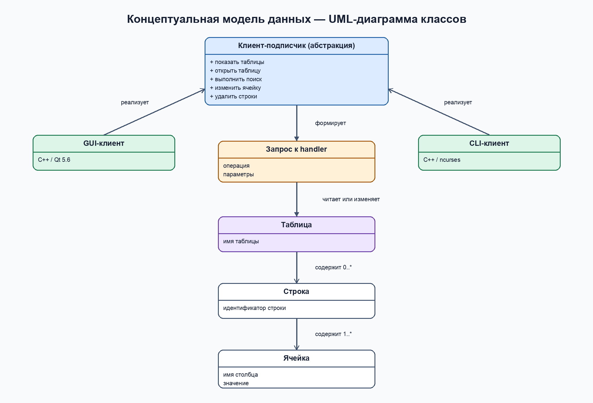
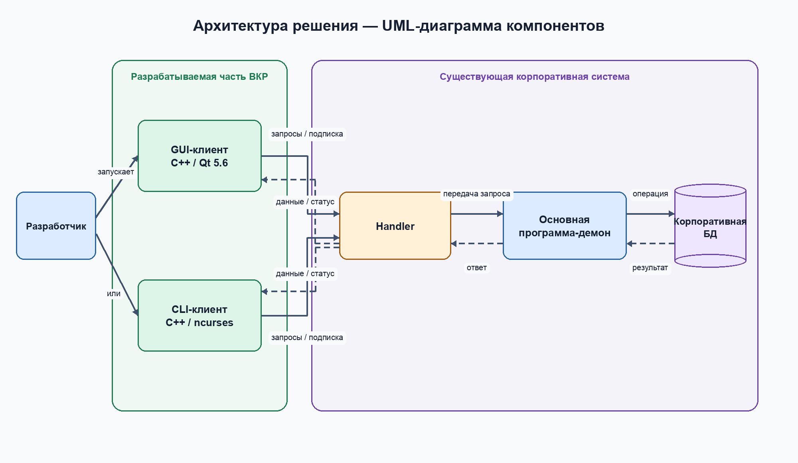
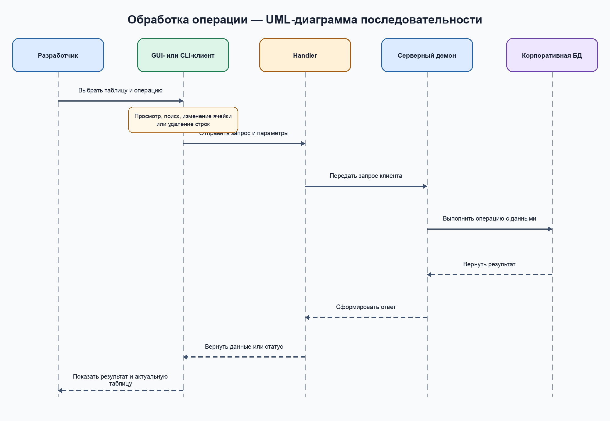
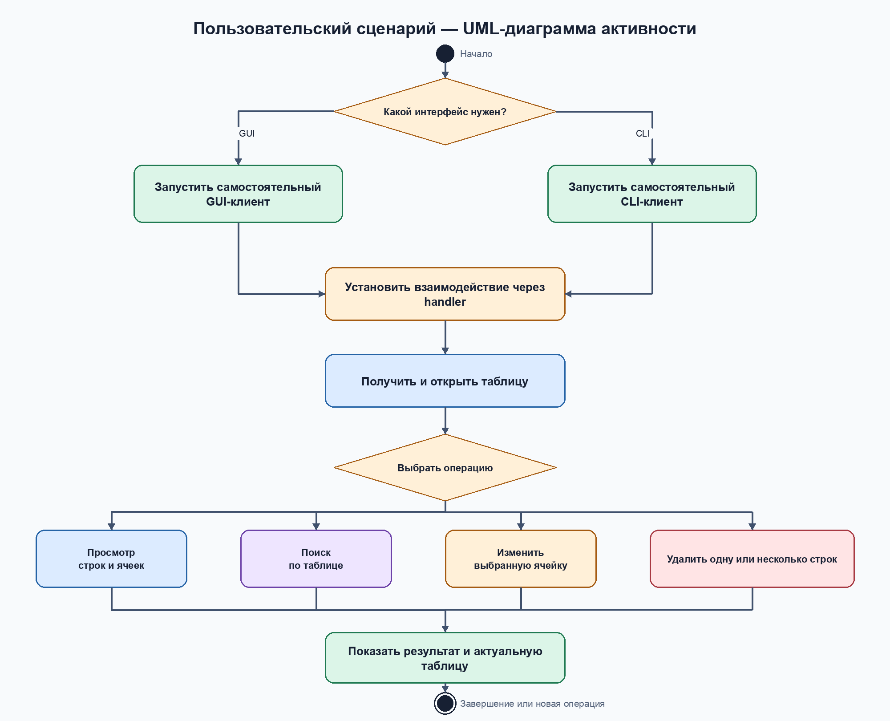
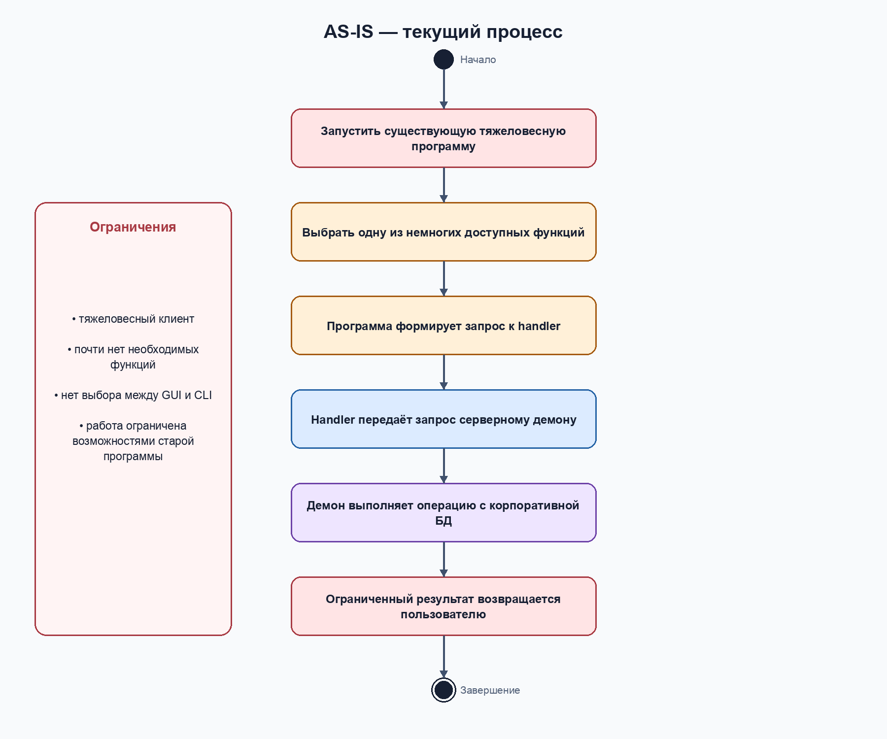
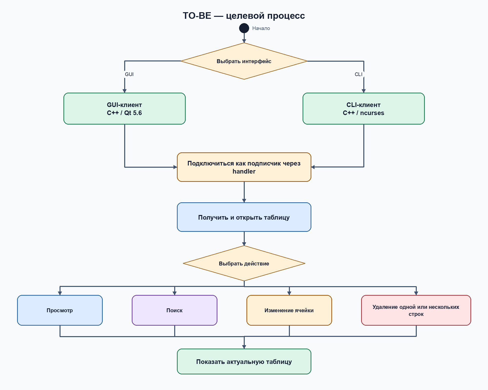

# ЛР 3 — проектирование

**Тема ВКР:** Создание интерактивного приложения для разработчиков корпоративной базой данных

**Автор:** Михайлов Егор Андреевич

**Научный руководитель:** Береснев Артем Дмитриевич

**Вклад при выполнении работы:** автор самостоятельно сформулировал требования к клиентским приложениям, выбрал виды диаграмм, описал архитектуру взаимодействия с существующей серверной программой и спроектировал модели AS-IS и TO-BE.

## 1. Предметная область и требования

### Описание предметной области

В корпоративной системе данные хранятся в базе данных, доступ к которой предоставляет уже существующая основная серверная программа, работающая в режиме демона. Серверный демон и база данных не являются предметом разработки в рамках ВКР. Взаимодействие клиентских программ с демоном выполняется через существующий handler: клиент отправляет запрос, handler передаёт его серверной программе, после чего клиент получает результат обработки.

В рамках ВКР разрабатываются две самостоятельные клиентские программы на C++. Первая программа имеет графический интерфейс на Qt 5.6, вторая — консольный интерфейс на ncurses. Программы не связаны друг с другом и не требуют совместного запуска: разработчик выбирает и запускает один из двух клиентов в зависимости от условий работы.

Оба клиента выступают подписчиками основной серверной программы и предоставляют разработчику операции для работы с табличными данными: просмотр таблиц, поиск, редактирование отдельной ячейки, удаление одной строки и удаление нескольких строк. Клиенты не обращаются к корпоративной базе данных напрямую и не изменяют серверный демон; все запросы проходят через handler.

### Функциональные требования

| ID | Требование | Как проверить выполнение |
|---|---|---|
| FR-01 | Клиент должен устанавливать взаимодействие с существующей серверной программой через handler и работать как её подписчик. | Запустить клиент и проверить по успешному ответу, что запрос прошёл через handler к серверной программе. |
| FR-02 | Клиент должен получать и отображать доступные пользователю таблицы корпоративной базы данных. | Запросить перечень таблиц и сопоставить отображённый список с ответом серверной программы. |
| FR-03 | Клиент должен отображать строки и ячейки выбранной таблицы. | Открыть выбранную таблицу и сравнить показанные значения с данными, возвращёнными handler. |
| FR-04 | Клиент должен выполнять поиск по данным выбранной таблицы. | Задать поисковое значение и убедиться, что клиент показывает строки, соответствующие ответу на поисковый запрос. |
| FR-05 | Клиент должен позволять изменить значение выбранной ячейки таблицы и передать изменение через handler. | Изменить ячейку, обновить таблицу и проверить наличие нового значения в повторно полученных данных. |
| FR-06 | Клиент должен позволять удалить одну выбранную строку через handler. | Удалить строку и после обновления убедиться, что она отсутствует в полученной таблице. |
| FR-07 | Клиент должен позволять выбрать и удалить несколько строк одной операцией. | Выбрать несколько строк, выполнить удаление и проверить их отсутствие после обновления данных. |
| FR-08 | После выполнения поиска, редактирования или удаления клиент должен отображать результат операции и актуальное состояние таблицы. | Последовательно выполнить каждую операцию и убедиться, что интерфейс показывает полученный результат и обновлённые данные. |
| FR-09 | Все перечисленные операции должны быть доступны как в GUI-клиенте, так и в CLI-клиенте. | Выполнить проверки FR-02–FR-08 отдельно в каждом клиенте. |

### Нефункциональные требования

| ID | Требование | Как проверить выполнение |
|---|---|---|
| NFR-01 | GUI-клиент должен быть реализован как самостоятельная программа на C++ с использованием Qt 5.6. | Собрать GUI-клиент в заявленной конфигурации и запустить его без CLI-клиента. |
| NFR-02 | CLI-клиент должен быть реализован как самостоятельная программа на C++ с использованием ncurses. | Собрать CLI-клиент в заявленной конфигурации и запустить его без GUI-клиента. |
| NFR-03 | Каждый клиент должен выполнять свои функции независимо от наличия и запуска второго клиента. | По отдельности запустить GUI- и CLI-клиент и выполнить проверки FR-01–FR-08. |
| NFR-04 | Интеграция клиентов не должна требовать изменения существующего серверного демона: обмен выполняется через handler. | Подключить каждый клиент к существующей серверной части и выполнить операции без внесения изменений в демон. |
| NFR-05 | При одинаковом состоянии базы оба клиента должны одинаково интерпретировать ответы handler для просмотра, поиска, редактирования и удаления данных. | Выполнить одинаковые сценарии в GUI и CLI и сопоставить полученные таблицы и результаты операций. |

## 2. Обзор нотаций и видов диаграмм

| Нотация или вид диаграммы | Что описывает | Сильные стороны |
|---|---|---|
| BPMN | Бизнес-процессы, участников, события, задачи и развилки процесса. | Наглядно показывает ответственность участников и изменение процесса от AS-IS к TO-BE. |
| IDEF0 | Функции системы и связанные с ними входы, выходы, управляющие воздействия и механизмы. | Удобна для функциональной декомпозиции и определения границ системы. |
| DFD | Процессы обработки данных, внешние сущности, хранилища и потоки данных. | Хорошо показывает происхождение данных и направления их передачи. |
| ER-диаграмма | Сущности базы данных, их атрибуты и связи. | Подходит для проектирования и проверки структуры конкретной базы данных. |
| UML-диаграмма вариантов использования | Акторов, цели пользователей и доступные им функции системы. | Позволяет проверить полноту пользовательских сценариев без детализации реализации. |
| UML-диаграмма классов | Статическую структуру объектов, их свойства, операции и отношения. | Подходит для концептуального описания табличных данных и клиентских объектов. |
| UML-диаграмма компонентов | Программные компоненты, предоставляемые интерфейсы и зависимости между частями системы. | Чётко отделяет разрабатываемые клиенты от существующих handler, демона и базы данных. |
| UML-диаграмма последовательности | Обмен сообщениями между участниками во времени. | Позволяет проследить полный путь запроса от пользователя до базы данных и обратно. |
| UML-диаграмма активности | Последовательность действий, условия, ветвления и завершение процесса. | Подходит для описания пользовательского сценария и сравнения процессов AS-IS и TO-BE. |

## 3. Выбор нотаций для проекта

Для проекта выбраны четыре вида UML-диаграмм. UML позволяет описать систему с нескольких согласованных точек зрения и при этом отделить разрабатываемые клиенты от существующей серверной части.

| Вид диаграммы | Что моделируем | Связанные требования | Почему подходит |
|---|---|---|---|
| UML-диаграмма классов | Концептуальную структуру данных клиента: таблицу, строку, ячейку, запросы поиска, изменения и удаления. | FR-02–FR-08, NFR-05 | Отражает структуру данных, с которой работают оба клиента, не приписывая проекту разработку корпоративной БД. |
| UML-диаграмма компонентов | Два независимых клиента, handler, существующий серверный демон и корпоративную БД. | FR-01, FR-09, NFR-01–NFR-04 | Показывает границы ВКР, независимость GUI и CLI, а также запрет прямого доступа клиентов к БД. |
| UML-диаграмма последовательности | Передачу пользовательского запроса через клиент, handler и демон к базе данных, а затем возврат результата. | FR-01, FR-04–FR-08, NFR-04–NFR-05 | Позволяет проверить взаимодействие компонентов и направление потоков данных. |
| UML-диаграмма активности | Выбор одного клиента и выполнение просмотра, поиска, редактирования или удаления. Также используется для AS-IS и TO-BE. | FR-02–FR-09, NFR-03 | Наглядно отражает бизнес-логику и точки, в которых требования реализуются в пользовательском процессе. |

ER-диаграмма была рассмотрена как средство описания структуры БД, но не выбрана для основной модели: корпоративная база и её конкретная схема уже существуют и не разрабатываются в рамках ВКР. В проекте важнее показать концептуальные табличные данные, границы компонентов и обмен через handler.

## 4. Модели системы

В репозитории диаграммы размещаются в каталоге `vkr/assets`. Имена классов на диаграмме являются концептуальными элементами модели, а не утверждением о фактических именах классов в исходном коде.

### 4.1 Концептуальная модель данных — UML-диаграмма классов

**Пояснение модели.** `GuiClient` и `CliClient` показаны как две альтернативные реализации общего набора пользовательских операций. Они не связаны между собой и самостоятельно работают с концептуальным представлением таблицы. Таблица состоит из строк, а строка — из ячеек. Поиск, изменение ячейки и удаление строк представлены запросом к handler.

**Отражённые функциональные требования и элементы модели.** `TableData`, `Row` и `Cell` отражают FR-02 и FR-03; операции `search`, `editCell` и `deleteRows` — FR-04–FR-07; наличие обеих реализаций клиента — FR-09.

**Нефункциональные требования и проектные решения.** Наследование на концептуальном уровне показывает одинаковую интерпретацию данных и операций обоими клиентами (NFR-05). При этом отдельные классы GUI и CLI соответствуют их самостоятельности и разным интерфейсным технологиям (NFR-01–NFR-03).

### 4.2 Архитектура решения — UML-диаграмма компонентов

**Пояснение модели.** Разработчик запускает либо GUI-, либо CLI-клиент. Клиенты являются независимыми компонентами и не обмениваются данными друг с другом. Единственная точка их интеграции с существующей системой — handler. Handler взаимодействует с серверным демоном, а демон — с корпоративной БД.

**Отражённые функциональные требования и элементы модели.** Связи клиентов с handler отражают FR-01; наличие двух альтернативных клиентов — FR-09; поток ответа с данными и статусом создаёт основу для FR-02–FR-08.

**Нефункциональные требования и проектные решения.** Граница `Разрабатываемая часть ВКР` фиксирует, что демон, handler и БД не изменяются (NFR-04). Отсутствие связи между GUI и CLI отражает независимость программ (NFR-03), а подписи компонентов — технологические ограничения NFR-01 и NFR-02.

### 4.3 Обработка операции — UML-диаграмма последовательности

**Пояснение модели.** Независимо от вида клиента запрос проходит один и тот же путь. Пользовательская программа отвечает за ввод операции и отображение результата, handler — за передачу запроса, демон — за работу с корпоративной БД.

**Отражённые функциональные требования и элементы модели.** Первый и последний шаги отражают FR-02–FR-08. Передача через handler соответствует FR-01, а единая последовательность для двух вариантов клиента — FR-09.

**Нефункциональные требования и проектные решения.** Отсутствие прямого сообщения от клиента к БД подтверждает NFR-04. Общий маршрут запросов и ответов для GUI и CLI обеспечивает основу для одинаковой интерпретации результата (NFR-05).

### 4.4 Пользовательский сценарий — UML-диаграмма активности

**Пояснение модели.** Сценарий начинается с выбора одного из двух независимых интерфейсов. После установления взаимодействия с существующей системой пользователь работает с таблицей и выбирает одну из доступных операций.

**Отражённые функциональные требования и элементы модели.** Получение и открытие таблицы соответствует FR-02 и FR-03; четыре ветви операций — FR-04–FR-07; показ актуального состояния — FR-08; альтернативный выбор интерфейса — FR-09.

**Нефункциональные требования и проектные решения.** Раздельные ветви запуска отражают NFR-01–NFR-03. Их объединение только перед взаимодействием через handler соответствует NFR-04 и единой логике обработки данных из NFR-05.

## 5. AS-IS и TO-BE

**Выбранная нотация:** UML-диаграмма активности.

### AS-IS — текущее состояние

**Описание и ограничения.** В текущем процессе разработчик вынужден запускать тяжеловесную программу с небольшим набором функций. Программа уже обращается к серверной части через handler, поэтому серверный маршрут запроса существует, но пользовательский интерфейс не обеспечивает требуемый набор удобных операций с таблицами. Ограничения AS-IS связаны с избыточной тяжеловесностью клиента и недостаточной функциональностью, а не с серверным демоном или базой данных.

### TO-BE — предлагаемое состояние

**Описание изменений.** В целевом процессе вместо тяжеловесной программы разработчик выбирает один из двух самостоятельных клиентов. GUI предназначен для графической работы, CLI — для терминального режима. Оба клиента используют существующий handler и серверный демон, поэтому изменение серверной части не требуется. В каждом интерфейсе доступны просмотр таблиц, поиск, редактирование ячейки и удаление одной или нескольких строк.

### Обоснование перехода

Переход от AS-IS к TO-BE выполняется заменой пользовательского клиентского компонента при сохранении существующего маршрута `handler → серверный демон → корпоративная БД`. На диаграмме TO-BE улучшение видно в двух точках:

1. Перед подключением пользователь выбирает подходящий самостоятельный интерфейс — GUI или CLI.
2. После открытия таблицы доступен полный требуемый набор операций, представленный отдельными ветвями процесса.

Такое решение устраняет зависимость пользователя от тяжеловесной программы с ограниченной функциональностью, но не требует переработки демона и корпоративной БД. Требования FR-01 и NFR-04 обеспечиваются сохранением handler как точки интеграции; FR-02–FR-08 — новыми операциями клиентов; FR-09 и NFR-01–NFR-03 — наличием двух независимых реализаций интерфейса.

## 6. Выводы

Выбранные виды UML-диаграмм соответствуют границам ВКР и предметной области. Диаграмма классов описывает концептуальную структуру табличных данных и операций, не выдавая существующую корпоративную БД за разрабатываемую часть проекта. Диаграмма компонентов отделяет два новых клиента от handler, серверного демона и базы данных. Диаграмма последовательности показывает единый маршрут запросов и ответов, а диаграмма активности связывает этот маршрут с действиями разработчика.

Модели согласованно отражают функциональные требования: получение и отображение таблиц, поиск, редактирование отдельной ячейки, удаление одной или нескольких строк и обновление результата. Нефункциональные требования представлены технологическими границами C++, Qt 5.6 и ncurses, независимостью клиентов, сохранением существующей серверной части и одинаковой интерпретацией ответов handler.

В модели AS-IS разработчик использует тяжеловесную программу с малым набором функций. В TO-BE он выбирает самостоятельный GUI- или CLI-клиент и получает необходимые операции с таблицами через уже существующий handler. Таким образом, улучшение достигается на клиентском уровне, а процессы, данные и взаимодействия остаются согласованными с действующей серверной архитектурой.
